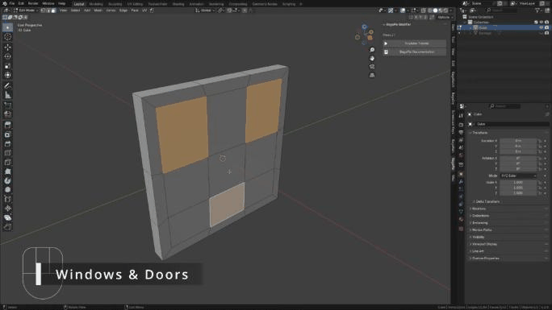

# Windows & Doors

Windows and doors are cut into a wall from selected faces. Unlike the other Edit Mode tools, they stay **parametric**.

## Add windows or doors

1. In Edit Mode, select one or more faces of the wall. Quads work best; n-gons are supported.
2. Press **D** and choose **Window Modern**, **Window Classic**, **Door Simple** or **Door Double**.
3. In the operator panel (bottom left), set the **wall thickness** and the boolean solver (**Exact** or **Fast**).

<figure class="demo" markdown="1">

<figcaption>Select faces on the wall, press D and choose a window. The wall is cut and the windows are created.</figcaption>
</figure>

The selected faces are copied to a new window (or door) object. Blender leaves Edit Mode on the wall. You get three objects: the wall, the window object and a hidden boolean object, which you do not need to edit.

## Edit after creation

- Select the window object and enter Edit Mode: each face is a window. Move or scale a face to move or resize its window; the wall topology does not change.
- Use loop cuts (**Ctrl + R**) on a window face to split it. Each frame adapts to its new size.
- All settings are in the BagaPie panel, with a **Material** section at the bottom.

## Window settings

| Section | Settings |
| --- | --- |
| **Main** | Global Offset, Depth, Windows Offset, Boolean Thickness, Boolean Offset, Reveal Thickness |
| **Glass** | Offset Glass |
| **Frame** | Width, Height, Bevel, Count Vertical / Horizontal |
| **Casing**, **Casing 2** | Width, Thickness, Bevel Radius, Bevel Count, Offset |
| **Shutters** | Simple or Double, Flip Side, Slide, Length Factor, Opening, Random Opening, Louvered or Solid, louver Count / Distance / Angle / Scale, Min Height |

Shutters may fail on some shapes. On n-gons (for example a round window) they are disabled automatically: shutters support quads only. If a few shutters fail, tweak **Min Height**.

## Door settings

| Section | Settings |
| --- | --- |
| **Main** | Global Offset, Depth, Door Offset, Boolean Thickness |
| **Door** | Double / Simple, Flip Side, Flip Wall Side, Thickness, Opening, Random Opening, Min Height |
| **Door Frame** | Profile options, Wall Frame, Frame Thickness |
| **Handle** | Handle Type or custom collection, Position X / Y, Top / Bottom Offset, Radius |
| **Hinge** | Offset |

Single and double door presets can be converted into each other, and you can switch the opening direction and the side of the wall.

!!! note
    The boolean depth is set for a 20 cm wall by default. For a thicker wall, increase the wall thickness in the operator panel, or **Boolean Thickness** afterwards.

## Remove

Select the window or door object and use **Remove** (−) in the BagaPie panel.
