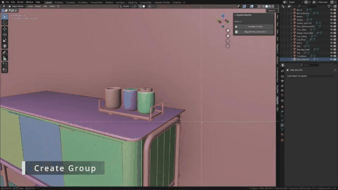

# Group

BagaPie groups put objects inside a common bounding box. They make large scenes easier to manage, work in animation, and can be turned into instances to lighten a scene.

## Create a group

Select the objects, press **J** and choose **Create Group**, or press **Ctrl + G**.

<figure class="demo" markdown="1">

<figcaption>Select the objects and choose Create Group. A bounding box is created and the group tools appear in the panel.</figcaption>
</figure>

BagaPie creates a bounding box. Its content is no longer selectable: select the box to move the whole group. Groups can contain other groups.

### Group shortcut

If the panel shows **Add Group Shortcut**, click it: **Ctrl + G** then creates groups, and gives quick access to the group tools when a group is selected. Save your preferences, or the shortcut is reset at the next start.

## Group tools

Select the bounding box to display the group tools in the BagaPie panel.

| Button | Action |
| --- | --- |
| **Make Content Selectable** / **Make Content Unselectable** | Unlock or lock the selection of the group content. **All** also applies to groups inside the group |
| **Group to Instance** | Replace the group with an instance (see below) |
| **Isolate** / **Unisolate** | Edit the group alone, then come back |
| **Ungroup** | Remove the group, keep the objects |
| **Delete Group (ALL)** | Delete the group and its content |
| **Add** / **Remove** (Group Content) | Add the selected objects to the group, or remove them |
| **Link Obj to Group Coll Only** | Unlink the group objects from every other collection |
| **Move Instance Group** | Move the group source without moving its instances |
| **Double Clic Edit** | Turn double click editing on (beta) |

**Link Obj to Group Coll Only** removes the objects from all collections except the group collection. If these objects are needed in other collections, do not use it.

### Add and remove content

- **Add:** select the objects to add, then the group (last), and click **Add**.
- **Remove:** make the content selectable, select the objects, and click **Remove**.

## Double click edit (beta)

With **Double Clic Edit** on, double click a group bounding box or a group instance to isolate it for editing. Double click in empty space, or click **Exit Editing**, to come back. Press **Esc** to turn double click editing off.

## Groups and instances

**Group to Instance** replaces the group with an empty that instances the group collection. The original group is moved to the world origin.

- Changes made to the group are repeated on every instance.
- Think of the empty as the world origin of the group: objects are placed relative to it.
- To move the source group without affecting its instances, use **Move Instance Group**. Use it only when instances of the group exist.
- Select an instance and click **Edit Instance Group**, or double click it, to edit the group.
- Duplicate instances freely to repeat elements in a scene.

**To Instance**, in the Manage section of the **J** pie, creates the group and the instance in one step.

## Duplicate

| Shortcut | Action |
| --- | --- |
| **Alt + J** | Duplicate the group and its content |
| **Alt + N** | Linked duplicate: meshes stay linked, like **Alt + D** compared to **Shift + D** |
