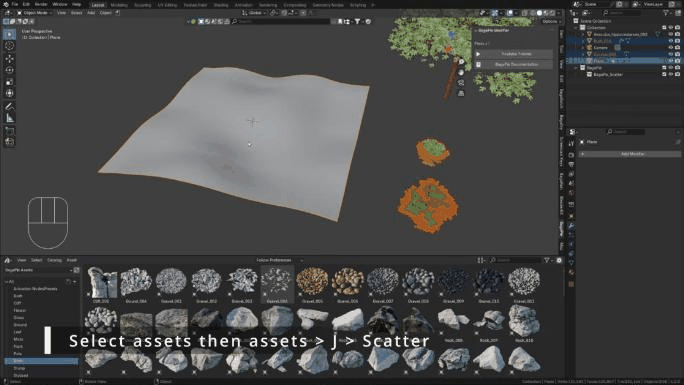

# BagaPie

BagaPie is a free, open-source toolbox for architecture and environment work in Blender. It gathers about fifty tools, most of them built on Geometry Nodes: scattering, ivy, arrays, walls, stairs, windows, booleans, groups and more.

**BagaPie 11 · Blender extension · GPL-3.0-or-later**

This edition follows BagaPie 11.0.11. Its extension manifest requires **Blender 5.0 or newer**. The BagaPie 11 tutorials apply to every BagaPie 11 build from Blender 4.2 onward; menus may differ slightly on older builds.

<figure class="demo" markdown="1">

<figcaption>Select assets, then the surface, press J and choose Scatter.</figcaption>
</figure>

## In short

1. Select what the tool needs: nothing, one object, or several objects with a target selected last.
2. Press **J** in Object Mode, or **D** in Edit Mode, and pick a tool.
3. Adjust the result in the **BagaPie** tab of the 3D Viewport sidebar (**N**).

Most tools stay parametric: you can change them at any time from the BagaPie panel. Edit Mode tools are applied as soon as you leave their operator panel, except Windows and Doors.

## Where to start

| If you want to… | Read |
| --- | --- |
| Install or update BagaPie | [Installation](getting-started/installation.md) |
| Understand selections, pie menus and the panel | [How BagaPie works](getting-started/workflow.md) |
| Scatter vegetation, rocks or props | [Scattering](object-mode/scatter.md) |
| Build walls, stairs, fences, floors | [Architecture](object-mode/architecture.md) |
| Add windows and doors to a wall | [Windows & Doors](edit-mode/windows-doors.md) |
| Organize a scene with groups and instances | [Group](group.md) |
| Install, create or share custom tools | [GeoPack](geopack/index.md) |

[Watch the tutorial playlist](tutorials.md) · [Get help on Discord](support.md)

## Support the development

BagaPie is free. Its development is funded by the optional **BagaPie Assets** library and by our other add-ons. BagaPie works the same way with your own assets.

---

*BagaCorp, Kiara Bagattini and Laura Mercadal. Special thanks to Alexandre Labedade (Alesk), Franck Demongin and Clovis Flayols, who contributed to its development.*
