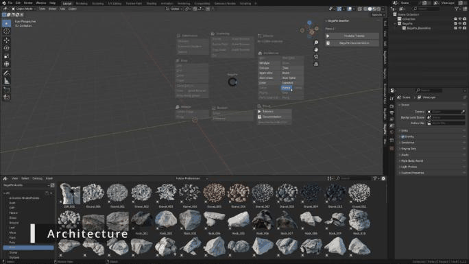

# Architecture

The Architecture section of the **J** pie menu creates fully parametric building elements. Every element has a **Material** section in the BagaPie panel.

Tools fall into three groups:

- **No selection needed:** a new object is created at the 3D cursor.
- **Curve tools:** they use the selected curve, or create one and switch to Draw mode.
- **Mesh tools:** they turn the edges or faces of the selected mesh into an element.

## No selection needed

| Tool | Main settings |
| --- | --- |
| **Column** | Height, Profile, Width, Depth, Bevel, Size, Count, Radius, Resolution |
| **Tiles** | Procedural or Custom tile, Type, Length, Height, Width, Width Offset, Thickness, Angle Tile, Count X / Y, Superposition, Shift, random Angle / Scale / Rotation, Seed |
| **Beam** | H beam: Width, Height, Length, Thickness, Int Offset, Bevel, Bevel Count |
| **Beam Wire** | Lattice beam: Sides Count, Radius, Section Height, Levels, Diameter, Diagonal, Profile, Triangulate, Bracing |
| **Stair Linear** | Depth, Step Height, Height, Width, Thickness, Type, Stringers, Handrail and Glass options, Balusters |
| **Stair Spiral** | Height, Radius, Width, Step Height, Rotation, Step Thickness, Invert, left / right Handrail, Balusters, Glass, Support Column, Stringer |
| **Floor** | X / Y / Z size, Vertices X / Y, Offset X / Y, random Offset, optional Custom mesh |

The object is created at the 3D cursor. Column, Tiles, Stair Linear, Stair Spiral and Floor are available when the active object is a mesh; the new object does not depend on it.

## Curve tools: Handrail and Fence

- **With a curve selected:** the modifier is added to that curve.
- **Without a curve:** BagaPie creates a new curve at the 3D cursor, enters Edit Mode with the Draw tool and projects the stroke on the surfaces under the cursor. Just draw.

<figure class="demo" markdown="1">

<figcaption>J > Fence with nothing selected: BagaPie switches to Draw mode, and the fence follows the stroke.</figcaption>
</figure>

Both tools have two modes:

- **Curve:** follows the curve shape.
- **Poly:** only uses the curve points, whatever the curve shape between them.

| Tool | Main settings |
| --- | --- |
| **Handrail** | Height, Module Length, Glass (Size, Offset, Thickness, Proportion, Connectors), Baluster profile and spacing, Handrail profile, Horizontal Baluster |
| **Fence** | Height, Fence Offset, Wall (Width, Even Thickness, Cap Flashing), Fence Vertical (Distance, Offset, Scale, random Scale / Rotation / Tangent), Profile, Timber Post, Fixation, Horizontal elements, Wire |

## Mesh tools

| Tool | Select | Result |
| --- | --- | --- |
| **Wall** | A mesh made of edges | Extrudes the edges into walls: **Wall Height** (2.4 m by default), **Wall Thickness** (0.2 m), **Wall Axis Offset** |
| **Wall Brick** | A mesh made of edges, or a curve | Brick walls: Height, Thickness, Length, Row Count, Row Offset, Horizontal Offset, random Position / Rotation / Scale, Deformation |
| **Pipes** | The target mesh(es) | Creates a curve and switches to Draw mode on the target. Pipes snap to a geometric pattern |
| **Cable** | The target mesh(es) | Creates a curve and switches to Draw mode. Cables hang between points |
| **Siding** | A mesh | Adds siding on faces aligned with the X, Y or Z axis |
| **Paving** | A mesh | Turns each face into paving |
| **Grid** | A mesh | Turns each face into a grid |
| **Perforated Grid** | A mesh | Turns each face into a perforated grid |
| **Plank** | A mesh | Turns each face into planks |

Wall works on edges. Applied to a closed volume such as a cube, it gives an unexpected result: use edges or a flat outline.

### Pipes

**Pipe / Poly / Curve** modes, Radius, Profile Resolution, Offset, **Precision** (higher values follow the drawn curve more closely), Resolution, Bevel, End Bevel, Junctions, Supports with Density / Depth / Probability, custom Junction, Valve and Tips objects, Materials.

Pipes break UVs. After applying the modifier, UVs are still available as an attribute: **Object Data Properties > Attributes**.

### Cable

Shape (Gravity, Rigidity, Resolution, Smooth, Start Offset, Start Rigidity, Edge Collision), Profile (Radius, Cable Count, Cable Radius, Rotation), Randomize (Radius Noise, Tilt Noise…), Fixation (Procedural or Custom: Thickness, Angle, Rings, Spacing, Length).

An Edit Mode **Cable Creator** works from selected edges; see [Mesh tools](../edit-mode/mesh-tools.md).

### Siding

Keep Original, then per axis (**X**, **Y**, **Z**): enable, Distance, Width, Thickness, Angle.

### Paving, Grid, Perforated Grid, Plank

These four tools share the same logic: they convert every face of the mesh into a pattern. Common settings are **Sharp Threshold**, **Rotation**, element **Length / Width**, offsets, scale, thickness and randomization with a **Seed**.

| Tool | Specific settings |
| --- | --- |
| **Paving** | Herringbone warp, Insert Tiles, Taper, Edging (scale, taper, width, thickness), Surface Deform |
| **Grid** | Distance X / Y, Offset Grid, Circle or Quad profile, Fix Tilt (Parallelogram) |
| **Perforated Grid** | Hole Offset, Herringbone warp, Random Thickness |
| **Plank** | Tile Skew, Random Deform, Random Rotate X / Y, Random Offset, Delete Small Area |

The same patterns exist in the Edit Mode pie as applied tools for selected faces only; see [Face To patterns](../edit-mode/face-to.md).

## Window (old)

The old Window tool is hidden by default. The **Window** button in the pie menu points you to the new window system in the Edit Mode pie (**D**). See [Windows & Doors](../edit-mode/windows-doors.md). You can show the old tool again in **Preferences > Pie Menu Tools**.
