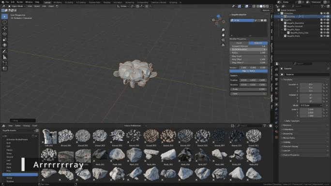

# Array

The Array section repeats objects along a line, a grid, a circle, a curve, a drawn stroke or a surface. Unlike Blender's Array modifier, BagaPie arrays include random position, rotation and scale.

## Line, Grid and Circle

Select **one** object (mesh or curve), press **J** and choose **Line**, **Grid** or **Circle**. Arrays support one object at a time; repeat the operation for each object.

| Type | Settings |
| --- | --- |
| **Line** | Count, Constant Offset, Relative Offset |
| **Grid** | Count X / Y, Constant Offset X / Y, Relative Offset X / Y, Midlevel X / Y |
| **Circle** | Count or Distance mode, Constant Distance, Count, Circle Resolution, Radius, Ring Count, Ring Offset, Ring Offset Z, Rotation, Align to Center |

All three have a **Random** section: Position, Rotation, Scale and Seed.

<figure class="demo" markdown="1">

<figcaption>Circle array: raise the Radius and the Circle Resolution, switch between Count and Distance, add rings.</figcaption>
</figure>

For a circle, a low **Circle Resolution** gives a polygonal shape: increase it for a round circle. Repetition can be based on a fixed **Count** or on the **Distance** between instances.

## Curve

Repeats an object along a curve.

1. Select the object to repeat.
2. Select the curve **last**.
3. Press **J** and choose **Curve**.

Settings: **Count** or **Length** mode, **Target** curve, **Rotation**, **Scale**, **Random Position / Rotation / Scale**, **Seed**, and **Align to Vector** with its **Vector**.

## Curve Deform

Deforms objects along a curve, like Blender's Array + Curve modifiers, which it uses.

1. Select the object(s).
2. Select the curve **last**.
3. Press **J** and choose **Curve Deform**.

Settings: **Axis**, **Use Relative Offset / Relative Offset**, **Use Constant Offset / Constant Offset**. The default axis usually fits. This array has no random options.

If BagaPie reports multi-user data, apply the rotation and scale of the objects first.

## Draw

Draws a curve and repeats the selected objects along it.

1. Select one or more objects.
2. Press **J** and choose **Draw** (or **Asset Browser** next to it to use assets selected in the Asset Browser).
3. Draw in the viewport.

BagaPie creates a new curve, enters Edit Mode with the Draw tool, and projects the stroke on the surfaces under the cursor. Settings: **Count** or **Length**, **Target**, **Rotation**, **Position**, **Align to Curve**, **Scale Min / Max**, random **Position / Rotation** and **Seed**.

## Array Along Shape

Repeats objects along the shape of a surface, following it by proximity.

1. Select the object(s) to repeat.
2. Select the surface to follow **last**.
3. Press **J** and choose **Array Along Shape**.

| Setting | Effect |
| --- | --- |
| **Count** | Number of instances |
| **Precision / Distance** | Accuracy of the spacing between instances |
| **Position, Rotation X / Y / Normal, Scale Min / Max, Seed** | Randomization |
| **Orientation Angle**, **Smooth Rotation** | Orientation of the instances |
| **Lock Axis X / Y / Z** | By default the array is locked to one axis. Unlock axes for a freer result |
| **Target** | The surface followed |

The array can fail on sharp edges (over about 70°). Add a Bevel modifier to the surface to round them.

An Edit Mode version that also deforms the repeated mesh is in the [Edit Mode pie](../edit-mode/mesh-tools.md).

## Remove

Use **Remove** (−) in the modifier stack.
