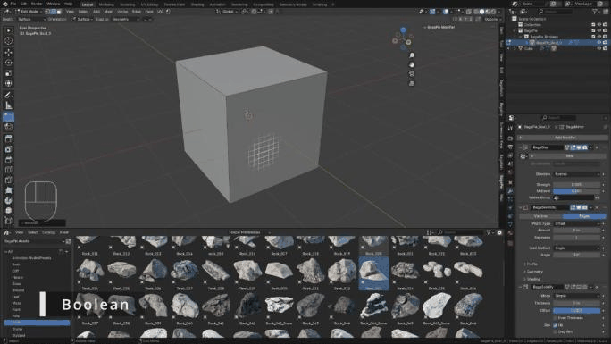

# Boolean

Quick, non-destructive booleans drawn directly in the viewport.

<iframe src="https://www.youtube-nocookie.com/embed/EKUg_FvDrgk?start=543" title="BagaPie 11 - Parametric Tools" loading="lazy" allow="accelerometer; clipboard-write; encrypted-media; gyroscope; picture-in-picture; fullscreen" allowfullscreen></iframe>

Video: <em>BagaPie 11 - Parametric Tools</em>, from 9:03.

## Add a boolean

1. Select a mesh.
2. Press **J** and choose **Union** or **Difference**.
3. BagaPie creates a hidden cutter object parented to your mesh, enters its Edit Mode and activates Blender's **Add Cube** tool.
4. Draw as many volumes as you need, then leave Edit Mode.

<figure class="demo" markdown="1">

<figcaption>J > Difference, then draw the cutting volumes with the Add Cube tool.</figcaption>
</figure>

The cutter is displayed as bounds and is invisible in renders. It is stored in `BagaPie > BagaPie_Boolean`.

## Settings

| Setting | Effect |
| --- | --- |
| **Boolean Type** | Union or Difference; Exact or Fast solver |
| **Use self**, **Hole Tolerant** | Blender boolean options, shown with the Exact solver |
| **Boolean Target: Bevel Segments / Bevel Size** | Bevel added to your mesh |
| **Boolean Object: Bevel Segments / Bevel Size** | Bevel added to the cutter |
| **Displace** | Small offset of the cutter, to avoid coplanar faces |
| **Use Solidify / Solidify / Solidify Offset** | Give thickness to the cutter, useful for flat shapes |
| **Mirror XYZ** | Mirror the cutter around your mesh, handy for symmetric sci-fi details |
| **More Boolean !** | Go back into the cutter's Edit Mode to add volumes; **EXIT** to leave |

## Apply and remove

**Apply** (✓) applies the boolean and the related modifiers. **Remove** (−) deletes the boolean and its cutter.
