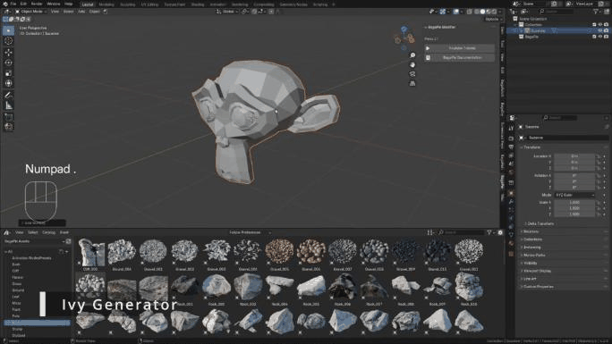

# Ivy

The Ivy tool grows procedural ivy on one or more target meshes.

## Add ivy

1. Place the 3D cursor where the ivy should start (**Shift + right click**).
2. Select the target mesh(es).
3. Press **J** and choose **Ivy**.

<figure class="demo" markdown="1">

<figcaption>Select the target, J > Ivy. Move the sphere empty to move the ivy source.</figcaption>
</figure>

BagaPie creates a sphere empty named `Ivy_Parent` at the 3D cursor. It is the ivy source: move it to move the ivy. The ivy grows toward the nearest target surface.

## Targets

- **Add a target:** select the new object, then the ivy, and click **Add** under **Target**.
- **Remove a target:** select the object, then the ivy, and click **Remove**.

## More sources

To add another ivy that shares the same targets and settings, place the 3D cursor, select the ivy and click **Add Ivy to 3D Cursor**. Added parts can be deleted with **Delete this part of ivy** when their source is selected. The original part can only be removed with the modifier.

## Settings

**Ivy**

| Setting | Effect |
| --- | --- |
| **Spiral / Grid Project** | Generation system: a spiral guide projected on the targets, or a projected grid |
| **View Guide** | Show the guide shape, to understand how the ivy is projected |
| **Radius** | Size of the guide |
| **Height / Loop** | Spiral mode only: height and number of loops of the spiral |
| **Gravity**, **Scale**, **Resolution** | Shape and detail of the ivy |
| **Density / Decimate** | Amount of leaves, and simplification |

**Random**

**Random Position**, **Emission Area**, **Surface Offset**, **Scale** and **Ivy Random Position** add variation to the growth and to the leaves.

**Collections**

**Target**, **Asset** and **Emitter** are the collections used by the modifier: the target meshes, the leaf assets and the ivy sources. You normally do not need to change them.

## Apply and remove

**Apply** (✓) converts the ivy to a mesh. **Remove** (−) deletes it.

The ivy is distributed according to the target surface area. If the target is animated or deformed, the ivy can change from frame to frame.
